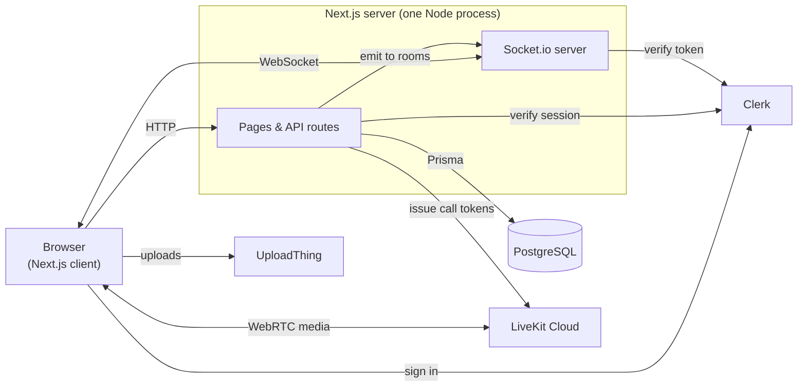

<div align="center">

# 💬 NodeSync

A full-stack, real-time chat app inspired by Discord. Text, direct messages,
voice, video, and screen sharing, all in one place.


</div>

## 👋 About

I'm a recent college grad looking for a developer role, and NodeSync is the
project I built to really learn how apps let people communicate with each other.
I didn't want to stop at sending text back and forth. My goal was to give users
all the essential ways to talk: servers and channels, private messages, voice
and video calls, and screen sharing.

Building it meant working through the parts that tutorials usually skip, like
keeping everything in sync in real time, making sure people can only see what
they're supposed to see, and changing the database after it already had real
data in it.

> 🚧 Not deployed yet. The app needs a long-running Node server for its
> WebSocket connections (more on that [below](#-design-decisions)), so it's
> headed for a host like Railway instead of a serverless platform.

<!--
## 📸 Screenshots

Add screenshots here, for example:


-->

## ✨ Features

**Servers & channels**
- Create servers, invite people with an invite link, and manage text, voice, and video channels
- Roles (**Admin / Moderator / Guest**) control who can manage channels, change roles, and kick members
- A **LIVE** badge shows up on a voice or video channel when someone in it is sharing their screen

**Messaging**
- Real-time messages, edits, and deletes over WebSockets
- Send up to 10 images (or a PDF) in a message, with an optional caption
- Emoji picker, and infinite scroll for older messages

**Friends & direct messages**
- Send, accept, decline, and remove friend requests, with live updates on both sides
- A Friends popup in the sidebar with pending requests and a badge count
- Discord-style DMs that belong to *people*, not servers, so you can message friends without sharing a server
- A Messages popup with unread counts that update the moment a message arrives

**Voice, video & screen sharing**
- Voice and video channels, plus 1-on-1 video calls in DMs, powered by LiveKit
- Screen sharing, with the shared screen taking over the main view

**Everything else**
- Sign up and sign in with Clerk
- Dark and light mode

## 🛠️ Tech Stack

| Layer | Tech | Why I picked it |
|---|---|---|
| Framework | **Next.js 16** (App + Pages Router), **React 19** | Server-rendered pages and API routes in one codebase |
| Language | **TypeScript** | Catches a whole class of bugs before they ever run |
| UI | **Tailwind CSS 4**, shadcn/ui + Base UI | Components I own and can tweak, no fighting a theme |
| Data fetching | **TanStack Query** | Caching and infinite scroll for message history |
| Auth | **Clerk** | Solid auth without rolling my own |
| Database | **PostgreSQL** with **Prisma** | Relational data (servers → members → channels → messages) with type-safe queries |
| Real-time | **Socket.io** | Persistent connections for instant updates |
| Voice & video | **LiveKit** | WebRTC calls and screen sharing without building a media server |
| File uploads | **UploadThing** | Files live in object storage, not on my server |
| Monorepo | **npm workspaces** + **Turborepo** | Shared UI package alongside the web app |

## 🏗️ How It Works



**Sending a message, start to finish:**
1. The chat input posts the message to an API route.
2. The route checks who you are from your session (never from anything the browser sends) and that you're actually allowed in that channel or DM.
3. Prisma saves the message to PostgreSQL.
4. The route emits the message over Socket.io, but **only to the room for that chat**.
5. Everyone with that chat open gets the event, and the message is added straight into their TanStack Query cache, so it shows up instantly without a refetch.

If the socket ever disconnects, the chat quietly falls back to polling every second until it reconnects.

## 🔒 Keeping Conversations Private

Real-time features are easy to get *working* and easy to get *wrong*. Early on,
every socket event went to every connected browser. Nothing sensitive was being
shown on screen, but anyone poking around in the console could have listened in
on a chat they didn't belong to. So I locked it down:

- **Sockets require a login.** When the browser connects, it sends its Clerk session token, and the server verifies it before accepting the connection.
- **Rooms you have to be allowed into.** Each user gets a personal room for their own notifications. To join a chat's room, the server first checks that you're in that channel's server or one of the two people in the DM.
- **Events only go where they belong.** Messages go to the chat's room; friend requests and DM notifications go to the person they're for.
- **Every API route checks permissions on its own.** For example, only the two people in a DM can read it, only the author can edit a message, and only the person who received a friend request can accept it.

## 🧗 The Hardest Part: Redoing Direct Messages

The hardest part of this project was getting private messages *untied* from
servers, which meant redoing them.

My first version stored a DM between two **server members**. It worked, but it
had real problems: you could only message someone you shared a server with, and
if you shared three servers with someone you ended up with three separate
conversations with them. That's not how anyone expects DMs to work.

So I rebuilt DMs around **people** (profiles) instead:

- A new `DirectConversation` model links two profiles directly, so friends can talk whether or not they share a server.
- The two profile IDs are always stored in sorted order, and a unique constraint on the pair guarantees **exactly one conversation per pair of people**, no matter who starts it.
- I built the new system **alongside** the old one, switched every link and badge over to it, and only then removed the old one, so the app never broke in between.
- Before dropping the old tables, I **copied the existing messages into the new system** (same authors, content, and timestamps), so no conversation history was lost.

It was a good lesson in changing a system that already has data in it, which is
a lot harder than designing one from scratch.

## 🧠 Design Decisions

- **Why not Vercel?** Socket.io needs a server that stays running and holds connections open. Serverless platforms spin functions up and down per request, so the WebSocket server can't live there. NodeSync runs as a normal Node server instead.
- **Why one process?** The Next.js routes and the Socket.io server share the same Node process, so any route can emit an event without an extra service in the middle.
- **Soft deletes for messages.** Deleted messages are marked as deleted instead of removed, so the conversation still reads naturally ("This message has been deleted.").
- **LiveKit for media.** Video and screen sharing are WebRTC under the hood. Instead of running my own media server, my server just issues short-lived LiveKit tokens, and only to people who belong to that channel or DM.

## ⚠️ Known Limitations

I'd rather be upfront about these than have someone find them first:

- **One server instance.** Socket rooms live in that server's memory. To run multiple instances behind a load balancer, I'd add the Socket.io Redis adapter so they can share rooms.
- **Schema changes use `prisma db push`.** That's fine for a solo project, but on a team I'd switch to tracked migrations (`prisma migrate`).
- **No automated tests yet.** That's the next thing I'd add, starting with the permission checks in the API routes.

## 🚀 What's Next

- **Video filters for calls.** This is the feature I'd most like to build next.
- Typing indicators and online/offline presence
- Automated tests and CI
- Deployment, with a live demo link right here

## 🧑‍💻 Running It Locally

**You'll need:** Node.js 20.9+, a PostgreSQL database, and accounts with Clerk,
UploadThing, and LiveKit.

1. **Install dependencies** from the repo root:
   ```bash
   npm install
   ```
2. **Create `apps/web/.env`** with these variables:
   ```bash
   DATABASE_URL=

   NEXT_PUBLIC_CLERK_PUBLISHABLE_KEY=
   CLERK_SECRET_KEY=
   NEXT_PUBLIC_CLERK_SIGN_IN_URL=
   NEXT_PUBLIC_CLERK_SIGN_UP_URL=
   NEXT_PUBLIC_CLERK_SIGN_IN_FALLBACK_REDIRECT_URL=
   NEXT_PUBLIC_CLERK_SIGN_UP_FALLBACK_REDIRECT_URL=

   UPLOADTHING_TOKEN=

   NEXT_PUBLIC_LIVEKIT_URL=
   LIVEKIT_API_KEY=
   LIVEKIT_API_SECRET=
   ```
3. **Set up the database** (from `apps/web`):
   ```bash
   npx prisma db push
   npx prisma generate
   ```
4. **Start the dev server** (from the repo root):
   ```bash
   npm run dev
   ```
   Then open [http://localhost:3000](http://localhost:3000).

## 📁 Project Structure

```
apps/web/
├── app/                 # App Router pages and API routes
│   ├── (main)/          # Servers, channels, DMs, and the Friends page
│   └── api/             # Channels, members, friends, messages, LiveKit tokens
├── pages/api/socket/    # Socket.io server and the routes that emit events
├── features/
│   ├── components/      # Chat, DMs, friends, navigation, modals, UI
│   └── hooks/           # Chat queries, sockets, and scrolling
├── lib/                 # Auth helpers, DM logic, socket rooms, Prisma client
└── prisma/              # Database schema
packages/ui/             # Shared Tailwind setup and UI components
```

## 📬 Contact

I'm actively looking for developer roles, so feel free to reach out!

- GitHub: [@MarquisPierre](https://github.com/MarquisPierre)
- Email: <!-- your email -->
- LinkedIn: <!-- your LinkedIn -->
