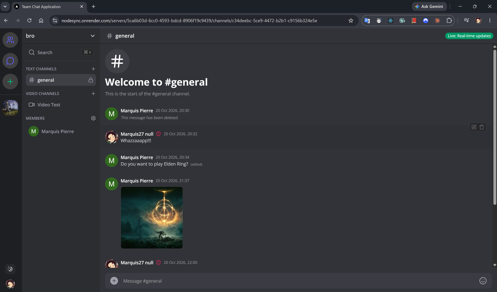
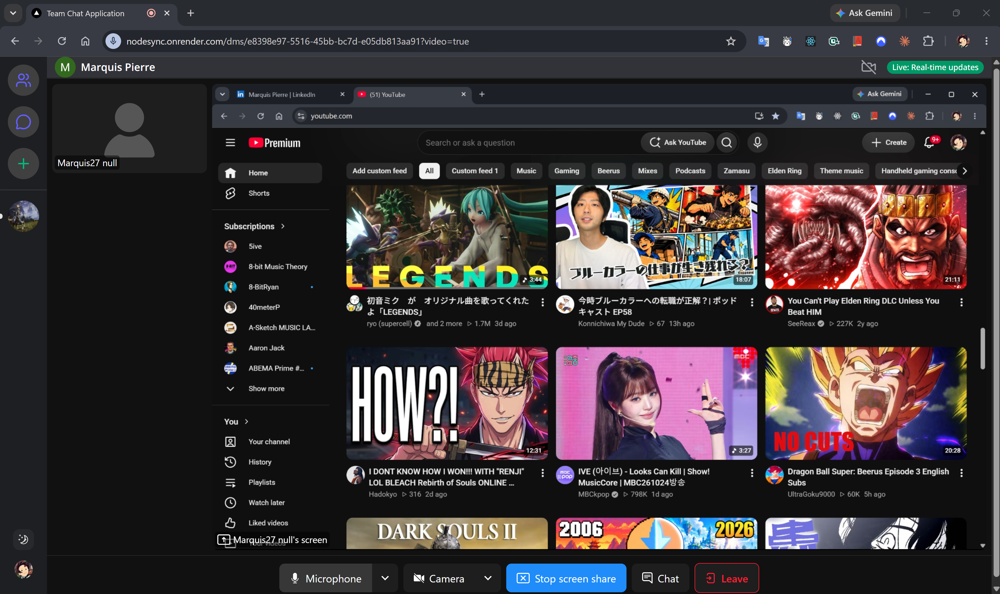
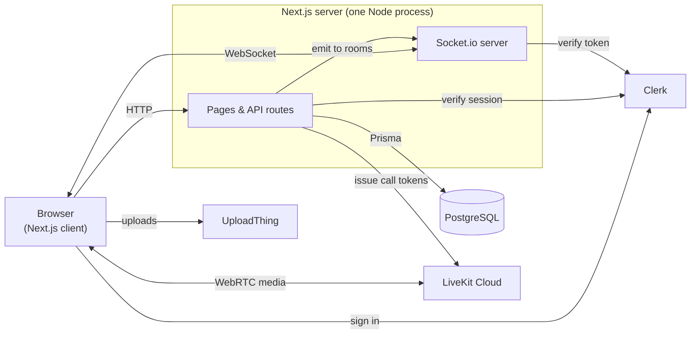

<div align="center">

# 💬 NodeSync

A real-time chat app inspired by Discord, with group channels, private messages, voice and video calls, and screen sharing.

[](https://nodesync.onrender.com)


</div>

## ⭐ Highlights

- **Instant messaging** — messages, edits, and notifications appear live for everyone in the chat (WebSockets)
- **Video calls and screen sharing** in group channels and private 1-on-1 chats (WebRTC via LiveKit)
- **Friends and private messages** with friend requests and unread-message badges, just like Discord
- **Rebuilt a core feature without losing user data** — redesigned how private messages work and safely moved all existing conversations to the new system
- **Built with security in mind** — users can only see and join the chats they belong to, with Admin, Moderator, and Guest roles


## 👋 About

I built NodeSync to learn how to create an application that allows users to
communicate with each other. My goal was to go beyond text messaging and give
users all the essential ways to communicate: servers and channels, private
messages, voice and video calls, and screen sharing.

The project involved keeping data synchronized in real time, ensuring users can
only access the conversations they belong to, and changing the database schema
after it already contained data.

> 🌐 **Live demo:** [nodesync.onrender.com](https://nodesync.onrender.com)
>
> The app runs on Render as a long-running Node server, which its WebSocket
> connections require (see [Design Decisions](#-design-decisions)). It is hosted
> on Render's free tier, so the first visit after a period of inactivity may take
> about a minute to load.

## 📸 Screenshots

**Text channel** with real-time messages, image attachments, and the live connection indicator



**Screen sharing** during a 1-on-1 video call in direct messages



## ✨ Features

**Servers & channels**
- Create servers, invite people with an invite link, and manage text, voice, and video channels
- Roles (**Admin / Moderator / Guest**) control who can manage channels, change roles, and kick members
- A **LIVE** badge appears on a voice or video channel when someone in it is sharing their screen

**Messaging**
- Real-time messages, edits, and deletes over WebSockets
- Send up to 10 images (or a PDF) in a message, with an optional caption
- Emoji picker and infinite scroll for message history

**Friends & direct messages**
- Send, accept, decline, and remove friend requests, with live updates on both sides
- A Friends popup in the sidebar with pending requests and a badge count
- Direct messages that belong to *users*, not servers, so friends can message each other without sharing a server
- A Messages popup with unread counts that update as soon as a message arrives

**Voice, video & screen sharing**
- Voice and video channels, plus 1-on-1 video calls in DMs, powered by LiveKit
- Screen sharing, with the shared screen taking over the main view

**General**
- Sign up and sign in with Clerk
- Dark and light mode

## 🛠️ Tech Stack

| Layer | Technology | Reason |
|---|---|---|
| Framework | **Next.js 16** (App + Pages Router), **React 19** | Server-rendered pages and API routes in one codebase |
| Language | **TypeScript** | Catches type errors at compile time |
| UI | **Tailwind CSS 4**, shadcn/ui + Base UI | Accessible components that live in the codebase and can be customized directly |
| Data fetching | **TanStack Query** | Caching and infinite scroll for message history |
| Auth | **Clerk** | Secure, production-ready authentication |
| Database | **PostgreSQL** with **Prisma** | Relational data (servers → members → channels → messages) with type-safe queries |
| Real-time | **Socket.io** | Persistent connections for instant updates |
| Voice & video | **LiveKit** | WebRTC calls and screen sharing without building a media server |
| File uploads | **UploadThing** | Stores files in object storage rather than on the application server |
| Monorepo | **npm workspaces** + **Turborepo** | Shared UI package alongside the web app |

## 🏗️ How It Works



**Message flow:**
1. The chat input posts the message to an API route.
2. The route identifies the user from their session (never from data supplied by the browser) and verifies that they belong to that channel or DM.
3. Prisma saves the message to PostgreSQL.
4. The route emits the message over Socket.io, but **only to the room for that chat**.
5. Every client with that chat open receives the event, and the message is added directly to its TanStack Query cache, so it appears immediately without a refetch.

If the socket disconnects, the chat falls back to polling every second until the connection is restored.

## 🔒 Keeping Conversations Private

In the first version, every socket event was broadcast to every connected
client. Although the UI only displayed the user's own chats, a user could have
subscribed to another chat's events from the browser console. I addressed this
with the following measures:

- **Sockets require a login.** When the browser connects, it sends its Clerk session token, and the server verifies it before accepting the connection.
- **Authorized rooms.** Each user has a personal room for their own notifications. Before a socket can join a chat's room, the server verifies that the user is a member of that channel's server or a participant in the DM.
- **Targeted events.** Messages are sent to the chat's room, while friend requests and DM notifications are sent only to the intended recipient.
- **Server-side authorization on every route.** For example, only the two participants in a DM can read it, only the author can edit a message, and only the recipient of a friend request can accept it.

## 🧗 The Hardest Part: Redoing Direct Messages

The most challenging part of this project was making private messages
independent of servers, which required redesigning them.

The first version stored a DM between two **server members**. This had two
problems: users could only message someone they shared a server with, and two
users who shared several servers had a separate conversation in each one.

I rebuilt DMs around **users** (profiles) instead:

- A new `DirectConversation` model links two profiles directly, so friends can talk whether or not they share a server.
- The two profile IDs are always stored in sorted order, and a unique constraint on the pair guarantees **exactly one conversation per pair of people**, no matter who starts it.
- I built the new system **alongside** the old one, migrated every link and badge to it, and only then removed the old one, so the app remained functional throughout.
- Before removing the old tables, I **migrated the existing messages to the new system** (preserving authors, content, and timestamps), so no conversation history was lost.

This taught me how to evolve a system that already contains data, which
requires more care than designing one from scratch.

## 🧠 Design Decisions

- **Long-running server instead of serverless.** Socket.io requires a server that stays running and holds connections open. Serverless platforms such as Vercel start and stop functions per request, so they cannot host the WebSocket server. NodeSync runs as a standard Node server instead.
- **Single process.** The Next.js routes and the Socket.io server share one Node process, so any route can emit an event without an additional service.
- **Soft deletes for messages.** Deleted messages are flagged rather than removed, so the conversation keeps its context ("This message has been deleted.").
- **LiveKit for media.** Video and screen sharing use WebRTC. Rather than running a media server, the application issues short-lived LiveKit tokens, and only to users who belong to that channel or DM.


## 📁 Project Structure

```
apps/web/
├── app/                 # App Router pages and API routes
│   ├── (main)/          # Servers, channels, DMs, and the Friends page
│   └── api/             # Channels, members, friends, messages, LiveKit tokens
├── pages/api/socket/    # Socket.io server and the routes that emit events
├── features/
│   ├── components/      # Chat, DMs, friends, navigation, modals, UI
│   └── hooks/           # Chat queries, sockets, and scrolling
├── lib/                 # Auth helpers, DM logic, socket rooms, Prisma client
└── prisma/              # Database schema
packages/ui/             # Shared Tailwind setup and UI components
```
